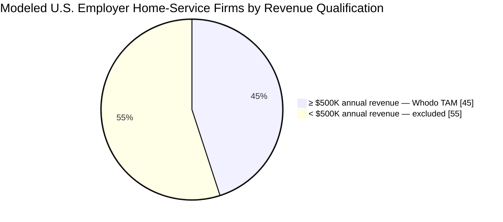

# Whodo Market Sizing for Investor Deck

## Executive Summary

Whodo is positioned as a workflow and customer-connection layer for service businesses, with integrations advertised for ServiceTitan, Podium, Dialpad, Google, and Stripe. Its current Pro tier is **$500/month**, or **$6,000 ARR per customer**, with unlimited users and consultations. The product emphasizes virtual consultations, booking, customer communication, AI assistance, and partner-network coordination.

For market sizing, the cleanest investor-grade definition is **U.S. employer home-services firms generating at least $500,000 in annual revenue**, concentrated initially in the trades most directly aligned with ServiceTitan: HVAC/plumbing, electrical, roofing, garage-door/building-equipment services, pest control, and landscaping. ServiceTitan itself identifies plumbing, electrical, HVAC, garage door, pest control, landscaping, roofing and related trades as core markets.

Using 2023 Census employer-establishment counts, an adjustment from establishments to firms, and a revenue-qualification model anchored to Census revenue-size data, I estimate a **U.S. TAM of approximately 150,000 eligible firms**, equivalent to roughly **$900 million of annual recurring revenue at Whodo's $500/month price**. A defensible range is roughly **$800 million–$1.1 billion ARR** depending on the proportion of employer firms exceeding the $500,000 revenue threshold.

Applying a **65% CRM/FSM-adoption assumption** produces a base **SAM of approximately 98,000 U.S. firms and $586 million ARR**. That assumption is supported by ServiceTitan research showing that **70% of surveyed commercial service contractors already use a CRM**, while older residential research found 63% using business-management software and 48% using field-service-management software.

A realistic 12–18 month goal is not "1% of the market." A more credible investor case is **125 active paid customers by month 12 and approximately 250 by month 18**, producing **$750,000 and $1.5 million in exit ARR**, respectively. At 250 customers Whodo would penetrate only about **0.26% of its modeled SAM**, leaving substantial headroom.

| Metric | Base case | Credible range |
|---|---:|---:|
| U.S. eligible firms ≥$500K revenue | ~150,000 | ~133,000–184,000 |
| Whodo price | $500/mo | Fixed assumption |
| ARR/customer | $6,000 | $6,000 |
| **TAM** | **~$901M ARR** | **~$800M–$1.10B** |
| CRM/FSM-addressable firms | ~97,600 | ~82,500–112,500 |
| **SAM** | **~$586M ARR** | **~$495M–$675M** |
| 12-month SOM | ~125 customers / **$750K ARR** | ~75–175 |
| 18-month SOM | ~250 customers / **$1.50M ARR** | ~120–350 |
| 18-month SAM penetration | **0.26%** | ~0.12%–0.36% |

The global market should **not yet be rolled into the headline TAM**. ServiceTitan itself says substantially all of its revenue remains U.S.-based and that less than 5% of revenue came from customers outside the United States in its July 2026 quarter, while also explicitly identifying international expansion as a future opportunity. For an investor deck, keeping the headline at **"~$900M U.S. TAM, global expansion upside not included"** is more defensible than inventing a global multiplier before Whodo selects target countries.

## Market Size Overview

**TAM Estimate.** The starting universe is approximately **362,700 employer establishments** across six mutually exclusive NAICS buckets that closely map to Whodo's initial home-services ICP. Census reports 111,207 plumbing/HVAC establishments, 83,342 electrical establishments, 25,519 roofing establishments, 117,969 landscaping establishments and 16,535 pest-control establishments in 2023. The broader Building Equipment Contractors group contains 202,656 establishments; subtracting electrical and plumbing/HVAC leaves approximately 8,107 "other building equipment" establishments, which provides a conservative proxy for garage-door and similar specialty-equipment contractors without double counting the other categories.

| Core Whodo vertical | Census / proxy NAICS | Employer establishments |
|---|---:|---:|
| Plumbing + HVAC | 238220 | 111,207 |
| Electrical | 238210 | 83,342 |
| Roofing | 238160 | 25,519 |
| Landscaping | 561730 | 117,969 |
| Pest control | 561710 | 16,535 |
| Garage door / other building equipment proxy | 238290 residual | ~8,107 |
| **Total** | | **~362,679** |

Because Census establishment counts can include multiple locations belonging to one firm, using the raw 362,679 as "customers" would overstate Whodo's opportunity. I therefore apply a **92% establishment-to-firm conversion factor**, yielding roughly **333,700 employer firms**. This is a modeling assumption rather than a Census statistic; it is intentionally below the 97% firm-to-establishment ratio visible in Census's landscaping revenue-size table, allowing for more multi-location behavior among larger plumbing, HVAC, electrical and roofing operators. Census's 2022 landscaping table reported 80,535 full-year firms operating 82,746 establishments.

The second filter is Whodo's explicit **$500,000 annual revenue minimum**. In the Census landscaping data, 36,654 of 80,535 full-year employer firms were in revenue bands of $500,000 or above, or about **45.5%**. I use **45% as the base qualification rate**, with a 40–55% sensitivity range. This is particularly reasonable for the Whodo ICP because ServiceTitan explicitly says it does not focus on the smallest "down-market" trades businesses with five employees or fewer.



The resulting base TAM is therefore:

**362,679 establishments × 92% firm adjustment × 45% ≥$500K revenue × $6,000 ARR = approximately $901 million ARR.**

That sits comfortably within the economic scale of the underlying industry. ServiceTitan estimated that its own currently served trades represented roughly **$650 billion in annual end-customer spend in the U.S. and Canada** and estimated a roughly **$13 billion serviceable software opportunity** based on capturing about 2% of customers' GTV. Whodo's modeled U.S. TAM of ~$0.9 billion is therefore only a fraction of the broader software wallet ServiceTitan believes exists in these trades.

**SAM Estimate.** Whodo is not realistically selling to every $500K+ contractor on day one. Its near-term serviceable market is the subset already operating with a CRM, FSM, or adjacent digital operating stack into which Whodo can integrate. ServiceTitan's 2025 commercial study found **70% CRM adoption**, while Deloitte's 2026 field-service study found 58% of field-service organizations already using an FSM and another 34% planning investment. Because Whodo includes both residential and commercial contractors, I use **65%** as a middle-ground adoption assumption.

That produces:

**~150,149 TAM firms × 65% software-ready = ~97,600 SAM firms**

**~97,600 × $6,000 ARR = ~$585.6 million SAM.**

A 55–75% adoption sensitivity gives a **$495M–$675M SAM range** before considering future international expansion.

ServiceTitan provides an especially attractive first wedge inside that SAM. The company reported approximately **10,800 active customers as of January 31, 2026**, and defines "active" as customers producing more than $10,000 in annualized ServiceTitan billings. Its current platform also serves businesses from family-owned operators to large enterprises, and ServiceTitan describes itself as deeply embedded across CRM, FSM, ERP, HCM and payments workflows.

At Whodo's price, converting only the current ServiceTitan installed base would represent a theoretical **$64.8 million ARR ecosystem wedge** before considering Jobber, Housecall Pro, Podium, FieldEdge and other CRM/FSM environments. This is not a separate TAM and should not be added to the $901 million; it is a subset of it.

**SOM Estimate.** A credible 12–18 month SOM should be built from sales capacity rather than arbitrary market-share percentages.

| Period | Active paying customers | Exit MRR | Exit ARR | SAM penetration |
|---|---:|---:|---:|---:|
| Month 12 | ~125 | $62,500 | **$750,000** | 0.13% |
| Month 18 base | ~250 | $125,000 | **$1.50M** | 0.26% |
| Month 18 downside | ~120 | $60,000 | **$720K** | 0.12% |
| Month 18 upside | ~350 | $175,000 | **$2.10M** | 0.36% |

The 250-customer base case is intentionally modest relative to the ecosystem. Jobber says more than **100,000 businesses** and 400,000 service professionals now use its platform; Housecall Pro reports more than **200,000 home-service professionals**; and ServiceTitan has approximately 10,800 active customers. Those figures demonstrate that specialized software can achieve meaningful penetration in the trades, although the companies target different company sizes and therefore their user counts should not be directly summed.

## Estimation Logic

The full bottom-up calculation is:

**Step A — define mutually exclusive verticals.** Use plumbing/HVAC, electrical, roofing, landscaping, pest control and other building equipment. These map closely to ServiceTitan's stated trade coverage and avoid using the entire construction industry, which would materially overstate Whodo's near-term ICP.

**Step B — count employer establishments.**

```text
111,207 + 83,342 + 25,519 + 117,969 + 16,535 + 8,107
= 362,679
```

These counts are based principally on 2023 Census County Business Patterns.

**Step C — convert establishments to customer firms.**

```text
362,679 × 92% = 333,665 modeled firms
```

The 92% factor is conservative relative to Census's landscaping data, where 80,535 full-year firms operated 82,746 establishments.

**Step D — apply the ≥$500K revenue requirement.**

```text
333,665 × 45% = 150,149 eligible firms
```

The 45% base assumption is anchored to the Census landscaping revenue-size distribution, where roughly 45.5% of full-year employer firms fall into $500K+ revenue bands. Because higher-ticket HVAC, plumbing, electrical and roofing companies may skew larger than landscapers, the model uses a broad 40–55% sensitivity range instead of pretending that 45% is exact for every trade.

**Step E — calculate TAM.**

```text
150,149 × $500 × 12
=$900.9M ARR
```

At the low and high revenue-qualification assumptions:

| ≥$500K share | Eligible firms | Whodo TAM |
|---:|---:|---:|
| 40% | ~133,500 | ~$801M ARR |
| **45% base** | **~150,100** | **~$901M ARR** |
| 50% | ~166,800 | ~$1.00B ARR |
| 55% | ~183,500 | ~$1.10B ARR |

**Step F — calculate SAM using technology readiness.**

```text
150,149 × 65%
=97,597 firms
```

```text
97,597 × $6,000
=$585.6M ARR
```

The 65% assumption is consistent with current evidence that software usage is already widespread among established contractors: 70% of surveyed commercial contractors reported CRM use, while ServiceTitan's older residential research found 76% of surveyed residential contractors using two to six software providers.

**Step G — construct SOM from a sales funnel.** A reasonable lean GTM assumption for months 1–18 is approximately 10,000 named accounts touched through founder-led sales, targeted outbound, ServiceTitan/CRM ecosystem relationships, industry events, referrals and digital inbound. A base funnel might produce ~1,000 meaningful sales conversations, ~500 qualified demos or pilots and ~300 gross closes. After onboarding losses and approximately **1.25% modeled monthly logo churn**, roughly 250 active customers at month 18 is feasible. These conversion and churn values are explicit planning assumptions, not observed Whodo performance.

The modeled sales cycle is **30–60 days**, which is reasonable for a $6,000-ARR operational SaaS purchase with relatively low procurement complexity, but it should be replaced with Whodo's actual cohort data as soon as enough closed-won deals exist. Whodo currently advertises no contracts and the ability to cancel at any time, so early retention should be modeled more conservatively than mature enterprise vendors.

ServiceTitan provides a useful long-run retention benchmark rather than a year-one assumption: it reported **gross dollar retention above 95% and net dollar retention above 110%** for fiscal 2026. Whodo should not claim comparable retention until demonstrated, but the benchmark shows the stickiness achievable once software becomes embedded in contractor workflows.

## Adjacent Market Benchmarks

| Platform | Core segment | Current pricing signal | Scale / penetration signal | Relevance to Whodo |
|---|---|---|---|---|
| **ServiceTitan** | Mid-market / enterprise trades | Core pricing quote-based; Dispatch Pro alone ranges from $138/managed tech monthly at low tiers down to $69 at 300+ techs | ~10,800 active customers; >2,000 customers above $100K annualized ServiceTitan billings | Strongest direct ecosystem wedge and proof that larger contractors spend heavily on workflow software. |
| **Jobber** | Small / growing home-service companies | Current paid tiers shown around $199–$499/mo depending plan and term | 100K+ businesses; 400K+ service pros | Demonstrates willingness to pay hundreds/month across a broad SMB service market. |
| **Housecall Pro** | SMB home services | ~$59/mo annual Basic; ~$149 Essentials; ~$299 Max annual, with higher monthly equivalents | 200K+ home-service professionals across 50+ industries | Large down-market installed base and future integration/channel opportunity. |
| **Podium Home Services** | Customer communication + AI + FSM | Quote-based AI Operating System | Public customer count not disclosed on the cited home-services page | Validates convergence of AI, communication, booking and FSM—the category Whodo is entering. |
| **Whodo** | $500K+ service businesses | **$500/mo Pro** | Early-stage | Pricing sits above lightweight SMB FSM tools but far below the effective software budgets of many ServiceTitan customers. |

Whodo's **$500/month** price therefore sits in a strategically plausible band. It is more expensive than entry-level Jobber or Housecall Pro plans but still small relative to the software spend of a $500K+ contractor. At exactly $500,000 annual revenue, Whodo costs **1.2% of revenue**; at $1 million, 0.6%; and at $5 million, only 0.12%. The economics improve rapidly as the ICP moves toward the $1M–$10M revenue range.

The market is also moving toward AI-enhanced operational software. ServiceTitan's September 2026 research found 62% of surveyed commercial service firms had piloted or deployed AI, while its broader trades study found contractors increasingly focused on AI integration with existing business software. This supports positioning Whodo as an integrated productivity layer rather than a standalone novelty AI tool.

## Assumptions & Sources

The most important distinction for the deck is **fact versus model**. Census counts, ServiceTitan customer counts, competitor pricing and software-adoption survey findings are externally sourced facts. The 92% establishment-to-firm factor, 45% blended ≥$500K qualification rate across all selected verticals, 65% software-readiness rate, 30–60 day sales cycle, funnel conversions and 1.25% monthly churn are **Whodo planning assumptions** that should be replaced by observed data as the company scales.

The model deliberately excludes nonemployer contractors, even though Census reports substantial numbers of them, because a business with no paid employees is less likely to fit Whodo's defined midsized ICP. Census's economic-census firm-size dataset itself covers firms with payroll, which aligns with the investor-deck definition used here.

The model also avoids counting every conceivable "home service" category. Pool service, septic, chimney, water treatment, cleaning, remodeling, restoration, windows, flooring and other adjacent segments could expand TAM later, but including them now would create a larger and less defensible headline. ServiceTitan itself lists many of these as supported industries, so they represent legitimate expansion upside.

## Deck Slide Summary

- **~$900M U.S. TAM:** approximately **150K employer home-service firms generating ≥$500K/year × $6K Whodo ARR**, with a defensible range of roughly **$800M–$1.1B** based on Census firm-size data.
- **~$586M U.S. SAM:** approximately **98K digitally mature firms** already using or ready for CRM/FSM workflows; 70% of surveyed commercial contractors already use CRM.
- **ServiceTitan is a powerful beachhead:** approximately **10,800 active customers**, implying as much as **$64.8M of Whodo ARR opportunity** at today's price before expanding across other CRM ecosystems.
- **Realistic 18-month SOM: ~250 customers / $1.5M ARR**, representing only **~0.26% penetration of SAM**; credible range is roughly **$720K–$2.1M exit ARR**.
- **Global expansion is upside, not baked into the headline:** keep the fundraising story anchored on the U.S. until specific international markets are selected; even ServiceTitan still generated less than 5% of revenue outside the U.S. as of July 2026.

## References

Sources are grouped by publisher. The research tool's inline citation markers did not map to specific URLs, so the "Likely source for" notes are inferred from the surrounding text. Confirm each figure against its source before it goes on a slide.

### U.S. Census Bureau

1. U.S. Census Bureau, 2023 County Business Patterns and industry profiles. https://data.census.gov/
   - Source for: 2023 employer-establishment counts by NAICS code (238220, 238210, 238160, 561730, 561710, and the 238290 residual).
2. U.S. Census Bureau, 2022 Economic Census, Firm Revenue Size table EC2200SIZEREVFIRM. https://data.census.gov/table/ECNSIZE2022.EC2200SIZEREVFIRM
   - Source for: landscaping firm and establishment counts (80,535 firms; 82,746 establishments), the 36,654 firms at $500K+ revenue (about 45.5%), and the 97% firm-to-establishment ratio.
3. U.S. Census Bureau, Statistics of U.S. Businesses. https://www.census.gov/programs-surveys/susb.html
   - Listed in the original source list. Not tied to a specific figure in the text.

### ServiceTitan

4. ServiceTitan, FY2026 Form 10-K (fiscal year ended January 31, 2026). https://www.sec.gov/Archives/edgar/data/1638826/000163882626000028/ttan-20260131.htm
   - Likely source for: about 10,800 active customers as of January 31, 2026, and the definition of "active" customers.
5. ServiceTitan, FY2027 Q2 Form 10-Q (quarter ended July 31, 2026). https://www.sec.gov/Archives/edgar/data/1638826/000163882626000094/ttan-20260731.htm
   - Likely source for: revenue from outside the U.S. (under 5%, July 2026 quarter).
6. ServiceTitan investor relations. https://investors.servicetitan.com/
   - Listed in the original source list. Not confirmed for any specific figure.
7. ServiceTitan, 2025 Commercial Service Market Report. https://www.servicetitan.com/press/2025-commercial-service-market-report
   - Likely source for: 70% CRM adoption among surveyed commercial contractors.
8. ServiceTitan, 2026 State of AI in the Trades. https://www.servicetitan.com/guides/2026-ai-in-the-trades
   - Likely source for: AI adoption and AI-integration findings in the benchmarks section.

### Competitors and Whodo

9. Jobber pricing and company scale. https://www.getjobber.com/pricing/ and https://www.getjobber.com/
   - Source for: Jobber tier prices and the 100K+ businesses / 400K+ service pros figures.
10. Housecall Pro pricing and company scale. https://www.housecallpro.com/pricing/
    - Source for: Housecall Pro tier prices and the 200K+ home-service professionals figure.
11. Whodo product and pricing. https://getwhodo.com/
    - Source for: the $500/mo Pro tier, unlimited users and consultations, integrations, and the no-contract cancellation policy.

### Cited in the text, but the URL was not kept

These figures appear in the text without a source URL. Find and attach the source before any of them goes in the deck.

- Deloitte, 2026 field-service study: 58% of field-service organizations use an FSM; another 34% plan investment.
- ServiceTitan older residential research: 63% use business-management software, 48% use FSM, and 76% use two to six software providers.
- ServiceTitan September 2026 research: 62% of surveyed commercial service firms have piloted or deployed AI.
- ServiceTitan statements on the down-market exclusion (five employees or fewer), the about $650B end-customer spend estimate, and the about $13B serviceable software estimate.
- ServiceTitan gross dollar retention above 95% and net dollar retention above 110% for fiscal 2026.
- Podium Home Services page: quote-based AI Operating System; customer count not disclosed.
- Dispatch Pro pricing ($138 to $69 per managed tech) and the more-than-2,000 customers above $100K annualized billings.
- IBISWorld: named as a possible secondary cross-check for trade revenue and business counts. Not used in any figure above.
